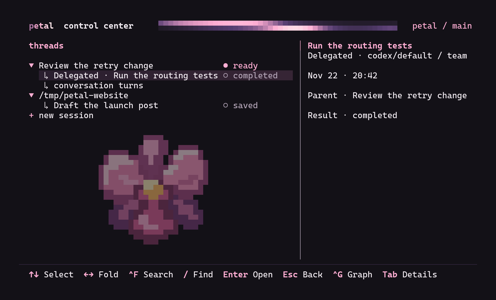
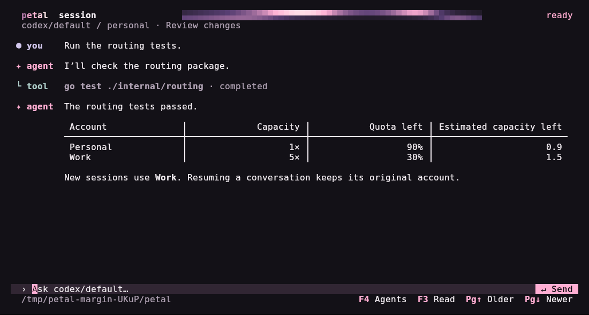

	
	<h1>Petal</h1>

Petal is a meta-harness that implements both the client and server sides of the Agent Client Protocol. Petal provides a beautiful TUI client, an agent server that can be integrated into your preferred Agent Development Environments, and a load balancer capable of maximizing usage across multiple Claude or Codex subscriptions.

Open Petal, pick a model. Petal checks the accounts that offer it and chooses the one with the most estimated quota left, weighted by subscription size. Each conversation stays on its account when you resume it. You can also pick the account yourself.

Petal is not a harness. Models run in their native, first-pary harnesses and are controlled via standard, supported APIs, so there's no ToS violation for using it.

Run `petal` for the terminal UI or `petal acp` to use the same load balancer from Zed or any other Agent Client Protocol (ACP) client.

## Start a session

1. Install the Claude Code or Codex CLI. Sign in with `claude` or `codex login`.
2. From the Petal checkout, run `nix profile install .#petal`. The package includes both ACP adapters.
3. Run `petal` in your project directory. Select **new session**, choose a model, and send a prompt.

Petal discovers the default profiles. If you have separate work and personal logins, [configure your subscriptions](docs/configuration.md#route-across-subscriptions).

To build without Nix, run `go build -o petal .` with Go 1.27.3 or later. Install `claude-agent-acp` or `codex-acp` on your path alongside the corresponding CLI.

## Use Petal

- [Navigate conversations, search transcripts, and send images](docs/terminal.md)
- [Connect Zed or another ACP client](docs/editors.md)
- [Run a custom ACP server, including OpenCode](docs/configuration.md#run-a-custom-acp-server)
- [Configure Petal with Home Manager](docs/configuration.md#install-with-home-manager)
- [Check ACP capabilities and test coverage](docs/acp.md)

[MIT license](LICENSE)
