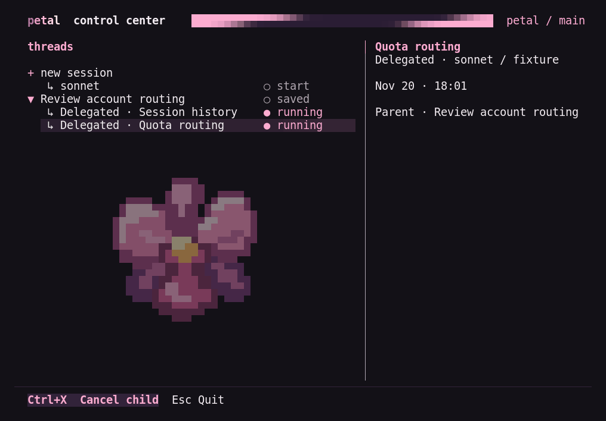
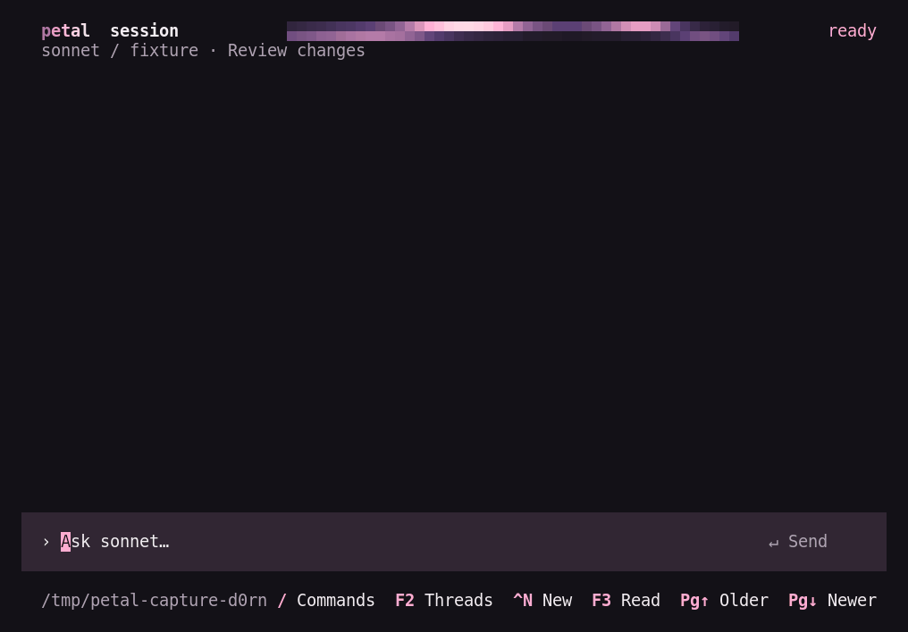

	
	<h1>Petal</h1>

Petal is a meta-harness that implements both the client and server sides of the Agent Client Protocol. Petal provides a beautiful TUI client, a proxied agent server accessible from your editor or other Agent Development Environment, and a load balancer which maximizes usage across multiple Claude or Codex subscriptions.

Pick a model and Petal [chooses an account](docs/configuration.md#how-quota-windows-affect-routing) based on remaining quota and subscription size. You can also pick the account yourself. Resuming a conversation keeps it on the same account.

Petal is not a harness. Models run in their native, first-party harnesses and are controlled via standard, supported APIs, so there's no ToS violation for using it.

Run `petal` for the terminal UI or `petal acp` to use the same load balancer from Zed or any other Agent Client Protocol (ACP) client.

## Start a session

1. Install the Claude Code or Codex CLI. Sign in with `claude` or `codex login`.
2. From the Petal checkout, run `nix profile install .#petal`. The package includes both ACP adapters.
3. Run `petal` in your project directory. Select **new session**, choose a model, and send a prompt.

Petal discovers the default profiles. If you have separate work and personal logins, [configure your subscriptions](docs/configuration.md#route-across-subscriptions).

To build without Nix, run `go build -o petal .` with Go 1.27.3 or later. Install `claude-agent-acp` or `codex-acp` on your path alongside the corresponding CLI.

## Use Petal

- [Navigate conversations, search transcripts, and send images](docs/terminal.md)
- [Connect Zed or another ACP client](docs/editors.md)
- [Run a custom ACP server, including OpenCode](docs/configuration.md#run-a-custom-acp-server)
- [Configure Petal with Home Manager](docs/configuration.md#install-with-home-manager)
- [Check ACP capabilities and test coverage](docs/acp.md)

[MIT license](LICENSE)
