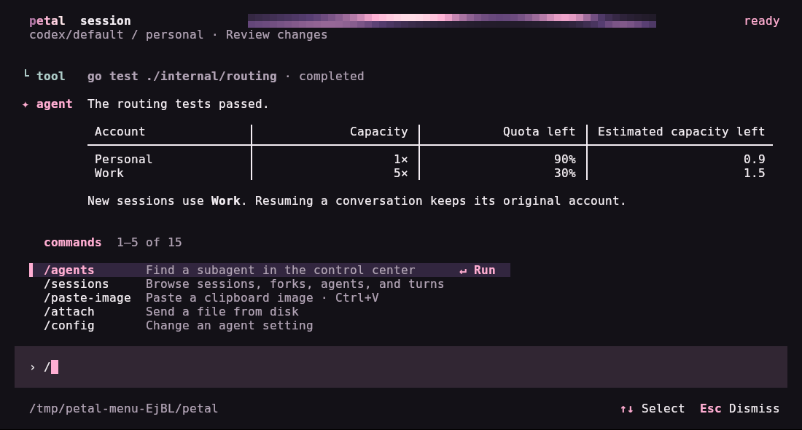

# Use Petal in the terminal

## Start a conversation

Run `petal` in your project directory. Select **new session** to choose a model, or press **Ctrl+N** to use the default. To pick the subscription yourself, press **Tab** in the model picker.

Send a prompt to start the turn. Petal displays the completed reply in the transcript. If you send another message while the agent works, Petal steers the turn when the adapter supports it. Otherwise, Petal queues a follow-up. Press **Escape** to cancel a running turn. Type `/` for commands from Petal and the agent.

## Find a conversation or message

Press **F2** or type `/sessions` to open the control center. Type to filter threads by title, model, or account. Press **Shift+Tab** to filter by status. To select your most recent saved thread at startup, run `petal --resume`. Petal keeps each thread's unsent draft until you exit.

To search the text of saved messages in this project, press **Ctrl+F** in the control center or type `/search` in chat. Use double quotes for an exact phrase. Press **Enter** to read a match in context and **Escape** to return to the results.

Use **Page Up** to scroll back or **F3** to open the full-screen reader. In the control center, open **conversation turns** to jump to a prompt in the active thread.

## Send an image

Paste into the composer, add a caption beside `[pasted image]`, and press **Enter**. Clipboard support depends on your terminal, including over SSH. Use **Ctrl+V** or `/paste-image` to request an image from the terminal clipboard. Petal accepts one pasted image up to 7 MiB per draft.

To send a file, use `/attach path/to/image.png`. The adapter must accept image prompts to receive it inline. Direct Kitty and Ghostty sessions preview PNG, JPEG, and the first frame of a GIF. Other terminals and multiplexers show captions. Transcript search indexes the caption.

## Browse forks and subagents

Use `/fork` to branch if the adapter can reopen forks. Use `/parent` to return.

Press **F4** or type `/agents` to focus a subagent in the thread tree. Use the arrow keys to expand or collapse a branch and **Tab** to view its details. Press **Ctrl+G** to open the agent graph. Select a connection and press **Enter** to follow it. Press **Escape** to return to the tree, or **r** to reveal the focused agent in **threads**.
